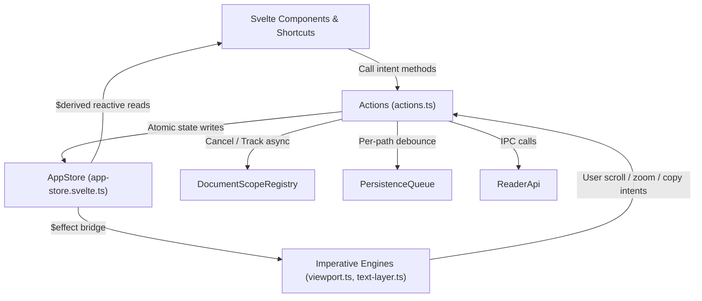

# Frontend Architecture: Vite + TypeScript + Svelte 5 (`CR-007`)

Authoritative technical design for migrating `reader`'s frontend from Vanilla ES modules to **Vite + TypeScript + Svelte 5 (Runes)** while keeping the Rust backend (`src-tauri/src/`) untouched.

---

## 1. Repository & Build Topology

### Target Directory Layout

```text
reader/
  index.html                     # Vite entrypoint (replaces src/index.html)
  package.json                   # pnpm scripts & pinned dev/runtime deps
  pnpm-lock.yaml                 # Committed lockfile
  vite.config.ts                 # Fixed port 1420, Tauri env, clean dist/ output
  tsconfig.json                  # Strict TypeScript config (shared by tsc & svelte-check)
  svelte.config.js               # vitePreprocess() for TS inside .svelte files
  vitest.config.ts               # Browser-condition resolution for Svelte 5 runes tests
  eslint.config.js               # Flat ESLint config (typescript-eslint + eslint-plugin-svelte)
  .prettierrc                    # Prettier + prettier-plugin-svelte
  public/
    logo.png                     # Relocated from src/logo.png
  dist/                          # Gitignored Vite production bundle (Tauri frontendDist)
  src/
    main.ts                      # Svelte 5 mount(App, { target }) + global CSS imports
    App.svelte                   # Top-level shell, Tauri lifecycle hooks, shortcuts binding
    styles/
      tokens.css                 # Locked 6-token palette + derived tokens (CSS custom props)
      base.css                   # Reset, focus rings, .sr-only, reduced-motion defaults
      viewport-layers.css        # Global rules for imperatively created page/canvas/text/search DOM
    lib/
      ipc/
        types.ts                 # 1-to-1 TypeScript DTOs matching src-tauri/src/
        errors.ts                # ReaderApiError, ErrorCode, normalizeApiError, isCancelledError
        binary.ts                # Binary render_page [u32 LE][u32 LE][RGBA8] -> ImageData decoder
        client.ts                # ReaderApi interface + Tauri v2 implementation (@tauri-apps/api)
      domain/
        title.ts                 # Document title derivation & parent directory splitting
        zoom.ts                  # ZOOM_STEPS, MIN_ZOOM, MAX_ZOOM, clampZoom, getNextZoomStep
        recents.ts               # RECENTS_PAGE_SIZE, filterRecentFiles, getVisiblePageItems
        outline.ts               # buildOutlineModel, resolveActiveOutlineNodeId, resolveVisibleActiveNodeId
        search.ts                # groupMatchesByPage, resolveInitialMatchIndex, stepMatchIndex
        format-error.ts          # Plain sentence-case error formatter (SPEC §5 copy rules)
      state/
        types.ts                 # TabState, DocState, BannerState, ShellMode, TransitionHooks
        doc-scope.ts             # Per-document AbortController registry + per-search abort scopes
        persistence.ts           # Per-path debounced PersistenceQueue (Map<canonicalPath, Entry>)
        app-store.svelte.ts      # Normalized Svelte 5 Runes store ($state + $derived)
        actions.ts               # Unidirectional intent handlers & single tab-transition pipeline
      engines/
        viewport-math.ts         # Pure geometry, binary search, DPR snapping, anchor math
        viewport.ts              # Imperative virtualized HiDPI canvas viewport engine
        text-copy.ts             # Pure formatCopiedFragments() clipboard geometry formatter
        text-layer.ts            # Imperative lazy text overlay + internal LRU cache + Range copy
        tab-drag.ts              # Imperative Pointer Events tab reorder + computeOtherVisualLefts
        shortcuts.ts             # Centralized keyboard & Ctrl+Wheel router reading store + actions
    components/
      icons/                     # Small inline SVG icon components (zero runtime icon packs)
      TabStrip.svelte            # Slim 32px borderless titlebar, keyed tabs, Home tab, `+` button
      WindowControls.svelte      # Minimize / Maximize-Restore / Close caption controls (CR-002)
      Toolbar.svelte             # Slim 36px document controls synced reactively to activeDoc
      NoticeBanner.svelte        # Workspace alert banner driven by store.banner
      HomeScreen.svelte          # 0-tab & Home-tab landing screen + inline home error
      RecentFiles.svelte         # Paginated, searchable recent files list (CR-004, CR-006)
      TocDrawer.svelte           # Collapsible 252px outline drawer + WAI-ARIA tree navigation
      TocTree.svelte             # Recursive outline list with lazy collapsed-branch rendering
      SearchBar.svelte           # Floating Ctrl+F search bar scoped to activeDoc
      ViewportHost.svelte        # $effect bridge mounting viewport.ts + text-layer.ts
      DropOverlay.svelte         # Native file drag-drop scrim
```

### Tauri v2 & CSP Configuration (`src-tauri/tauri.conf.json`)

Only `build` and `app.withGlobalTauri` change in `src-tauri/tauri.conf.json`:

```json
{
  "build": {
    "beforeDevCommand": "pnpm dev",
    "beforeBuildCommand": "pnpm build",
    "devUrl": "http://localhost:1420",
    "frontendDist": "../dist"
  },
  "app": {
    "withGlobalTauri": false
  }
}
```

- **Transition rule for `withGlobalTauri`**: Keep `"withGlobalTauri": true` during Phases 0–2 while legacy `src/api.js` still runs via Vite. Flip `"withGlobalTauri": false` in **Phase 3** when `src/main.ts` cuts over to `@tauri-apps/api`.
- **Production CSP Compatibility**: `src-tauri/tauri.conf.json` enforces:
  ```text
  default-src 'self'; script-src 'self'; style-src 'self'; img-src 'self'; font-src 'self'; connect-src 'self' ipc: http://ipc.localhost https://ipc.localhost; object-src 'none'; base-uri 'none'; frame-ancestors 'none'; form-action 'none'
  ```
  - Svelte 5 compiles all templates and `<style>` blocks ahead-of-time into static JS and CSS assets under `dist/assets/`. No `eval`, `new Function`, or runtime `<style>` tag injection occurs.
  - Inline element styles set via Svelte `style:` directives or `el.style.*` modify DOM CSSOM properties directly and do **not** violate `style-src 'self'`.
  - During `cargo tauri dev`, Tauri v2 automatically augments CSP for `devUrl` (`http://localhost:1420` / HMR WebSocket) while enforcing the strict policy verbatim in `cargo tauri build`.

### Vite & TypeScript Rules

- **`vite.config.ts`**:
  - `clearScreen: false`, `server: { port: 1420, strictPort: true, watch: { ignored: ["**/src-tauri/**"] } }`.
  - `build: { target: "es2022", outDir: "dist", emptyOutDir: true }` (Windows WebView2 runs Chromium Evergreen; no legacy polyfills needed).
- **`tsconfig.json`**:
  - `strict: true`, `noUncheckedIndexedAccess: true`, `noFallthroughCasesInSwitch: true`, `moduleResolution: "bundler"`, `isolatedModules: true`, `verbatimModuleSyntax: true`, `noEmit: true`.
  - Never use `any` in production `.ts` / `.svelte` files; narrow unknown errors through `normalizeApiError()`.

---

## 2. Typed IPC Boundary (`src/lib/ipc/`)

All 10 Rust IPC commands in `src-tauri/src/commands.rs` remain unchanged. `src/lib/ipc/types.ts` mirrors Rust structs field-for-field in `snake_case`:

```ts
export type ZoomMode = "fit_width" | "fit_page" | "custom";

export type ErrorCode =
  | "io"
  | "unsupported_format"
  | "password_protected"
  | "invalid_document"
  | "page_out_of_range"
  | "document_not_found"
  | "cancelled"
  | "internal";

export interface ErrorResponse {
  readonly code: ErrorCode;
  readonly message: string;
}

export interface DocumentMetadata {
  readonly title: string | null;
  readonly author: string | null;
  readonly page_count: number;
}

export interface PageDimensions {
  readonly width_pt: number;
  readonly height_pt: number;
}

export interface ReadingPosition {
  readonly page_index: number;
  readonly zoom_mode: ZoomMode;
  readonly zoom_scale: number;
}

export interface RecentFile {
  readonly path: string;
  readonly title: string;
  readonly last_opened_unix: number;
  readonly last_page: number;
  readonly page_count: number;
}

export interface PersistedState {
  readonly version: number;
  readonly recent_files: RecentFile[];
  readonly positions: Record<string, ReadingPosition>;
}

export interface OpenDocumentResponse {
  readonly document_id: number;
  readonly canonical_path: string;
  readonly metadata: DocumentMetadata;
  readonly page_dimensions: PageDimensions[];
  readonly saved_position: ReadingPosition | null;
  readonly already_open: boolean;
}

export interface NormalizedRect {
  readonly x: number;
  readonly y: number;
  readonly width: number;
  readonly height: number;
}

export interface OutlineItem {
  readonly title: string;
  readonly page_index: number | null;
  readonly children: OutlineItem[];
}

export interface TextSpan {
  readonly text: string;
  readonly rect: NormalizedRect;
}

export interface SearchMatch {
  readonly page_index: number;
  readonly rects: NormalizedRect[];
}
```

### Injectable `ReaderApi` Contract (`src/lib/ipc/client.ts`)

Wrap Tauri calls behind a typed interface so **all state, actions, persistence, and engine tests run in Vitest with an in-memory fake `ReaderApi` (zero WebView dependency)**:

```ts
export interface RenderPageParams {
  documentId: number;
  pageIndex: number;
  widthPx: number;
  heightPx: number;
  epoch: number;
}

export interface SaveReadingStateParams {
  path: string;
  pageIndex: number;
  zoomMode: ZoomMode;
  zoomScale: number;
}

export interface DragDropHandlers {
  onEnter?: (paths: string[]) => void;
  onDrop?: (paths: string[]) => void;
  onLeave?: () => void;
}

export interface WindowControlsApi {
  minimize(): Promise<void>;
  toggleMaximize(): Promise<void>;
  close(): Promise<void>;
  isMaximized(): Promise<boolean>;
  onResized(handler: () => void): Promise<() => void>;
}

export interface ReaderApi {
  getInitialFile(): Promise<string | null>;
  getPersistedState(): Promise<PersistedState>;
  openDocument(path: string): Promise<OpenDocumentResponse>;
  closeDocument(documentId: number): Promise<void>;
  renderPage(params: RenderPageParams): Promise<ImageData>;
  getOutline(documentId: number): Promise<OutlineItem[]>;
  getPageText(documentId: number, pageIndex: number): Promise<TextSpan[]>;
  searchDocument(documentId: number, query: string): Promise<SearchMatch[]>;
  saveReadingState(params: SaveReadingStateParams): Promise<void>;
  removeRecentFile(path: string): Promise<PersistedState>;
  pickPdfFiles(): Promise<string[]>;
  subscribeDragDrop(handlers: DragDropHandlers): Promise<() => void>;
  getWindowControls(): WindowControlsApi;
}
```

- **Production bindings**:
  - `invoke` from `@tauri-apps/api/core` (note: binary `tauri::ipc::Response` returns `ArrayBuffer`, decoded via `decodeRenderFrame(buffer)` in `src/lib/ipc/binary.ts`).
  - `open` from `@tauri-apps/plugin-dialog` (`multiple: true`, `directory: false`, `filters: [{ name: "PDF Documents", extensions: ["pdf"] }]`).
  - `getCurrentWebview().onDragDropEvent(...)` from `@tauri-apps/api/webview`.
  - `getCurrentWindow()` from `@tauri-apps/api/window` (respecting exact permissions in `src-tauri/capabilities/default.json`).

---

## 3. Svelte 5 Runes State & Synchronization Architecture (`src/lib/state/`)

### Core Invariant: Single Source of Truth + Unidirectional Data Flow



**Strict Ownership Rules**:
1. Components **never** mutate store fields directly and **never** call sibling components' methods.
2. All mutations flow through `actions.ts` (the single writer layer).
3. Non-UI runtime caches (`textCache` LRU maps, `<canvas>` elements, `pageOffsets`, `IntersectionObserver`) **never** enter `$state` — they live strictly inside `src/lib/engines/`.
4. **Svelte 5 Collection Rule**: Never place raw ES `Map` or `Set` inside `$state` expecting fine-grained reactivity on `.set()` / `.add()` / `.delete()`. Use **`SvelteMap`** / **`SvelteSet`** from `svelte/reactivity` (for `docsById`, `tabsById`, `expandedIds`) or plain reactive arrays/objects.

### Normalized Store Schema (`src/lib/state/app-store.svelte.ts`)

```ts
export const HOME_TAB_ID = "home" as const;

export type TabItem =
  | {
      readonly kind: "home";
      readonly tabId: typeof HOME_TAB_ID;
      readonly title: "Home";
      returnToTabId: string | null;
    }
  | {
      readonly kind: "document";
      readonly tabId: string; // `doc-${documentId}`
      readonly documentId: number;
      readonly title: string;
      readonly canonicalPath: string;
    };

export interface ScrollAnchor {
  readonly pageIndex: number;
  readonly topOffsetRatio: number;
}

export interface DocViewState {
  pageIndex: number;
  scrollTop: number | null;
  scrollAnchor: ScrollAnchor | null;
  zoomMode: ZoomMode;
  zoomScale: number;
}

export interface DocOutlineState {
  open: boolean;
  status: "idle" | "loading" | "loaded" | "error";
  model: OutlineModel | null;
  error: string | null;
  expandedIds: SvelteSet<string> | null;
  scrollTop: number;
  selectedNodeId: string | null;
}

export interface DocSearchState {
  open: boolean;
  query: string;
  lastSearchedQuery: string;
  status: "idle" | "searching" | "ready" | "error";
  matches: SearchMatch[];
  matchesByPage: Map<number, PageSearchEntry[]>; // replaced atomically per search result
  currentIndex: number;
  errorMessage: string | null;
  /** Monotonic counter incremented when highlight overlays must repaint. */
  highlightVersion: number;
  /** Monotonic counter incremented when viewport should scroll to the active match. */
  scrollToMatchSeq: number;
}

export interface DocState {
  readonly documentId: number;
  readonly canonicalPath: string;
  readonly title: string;
  readonly pageCount: number;
  readonly pageDimensions: readonly PageDimensions[];
  view: DocViewState;
  outline: DocOutlineState;
  search: DocSearchState;
}

export interface BannerState {
  readonly scope: "home" | "workspace";
  readonly message: string;
  readonly actionLabel?: string;
  readonly onAction?: () => void;
}

export type ShellMode = "empty" | "home_tab" | "document";
```

**Store Fields & `$derived` Selectors** (encapsulated in a `createAppStore()` factory class/object so every Vitest test creates an isolated fresh instance — **no module-level singleton globals!**):

- **Reactive `$state`**:
  - `tabOrder: string[]` (single source of truth for tab-strip visual order, `Ctrl+Tab`, `Ctrl+1..9`, and drag reorder)
  - `tabsById: SvelteMap<string, TabItem>`
  - `docsById: SvelteMap<number, DocState>`
  - `activeTabId: string | null`
  - `recents: RecentFile[]`
  - `recentQuery: string`
  - `recentPage: number`
  - `banner: BannerState | null` (unifies `#notice-banner` and `#empty-error`)
  - `isDraggingFiles: boolean`
  - `isWindowMaximized: boolean`
- **Derived `$derived` (never manually synced)**:
  - `orderedTabs`: `tabOrder.map((id) => tabsById.get(id)).filter(Boolean)`
  - `activeTab`: `activeTabId ? tabsById.get(activeTabId) ?? null : null`
  - `activeDoc`: `activeTab?.kind === "document" ? docsById.get(activeTab.documentId) ?? null : null`
  - `isHomeActive`: `activeTabId === HOME_TAB_ID`
  - `hasAnyTabs`: `tabOrder.length > 0`
  - `shellMode`: `activeDoc ? "document" : isHomeActive ? "home_tab" : "empty"`
  - `windowTitle`: `activeDoc ? `${activeDoc.title} — Reader` : isHomeActive ? "Home — Reader" : "Reader"`
  - `toolbarModel`: derived `{ pageIndex, pageCount, zoomMode, zoomScale, tocOpen, searchOpen }` from `activeDoc`
  - `filteredRecents`, `totalRecentPages`, `clampedRecentPage`, `pagedRecents`, `recentRangeLabel` (CR-004 + CR-006 computed purely from `recents`, `recentQuery`, `recentPage`)

### Single Tab-Activation Pipeline (`src/lib/state/actions.ts`)

Replaces the 5 duplicated transition paths in legacy `src/main.js` with **one** internal helper `deactivateCurrentDocument(options)`:

1. **Before switching away from an active document** (`deactivateCurrentDocument({ flushSave, clearPendingSave })`):
   - Invoke registered lightweight transient DOM hooks (`hooks.cancelPageInput?.()`, `hooks.captureTocScroll?.(doc)`, `hooks.captureViewportSnapshot?.(doc)`).
   - If closing this tab: cancel any queued debounced save for `doc.canonicalPath` and return the final snapshot to persist once explicitly.
   - If switching away (to another doc or Home): enqueue + flush pending save for `doc.canonicalPath` only if dirty/captured.
2. **Commit tab change atomically**:
   - Update `activeTabId` (and `tabOrder` / `tabsById` / `docsById`).
   - Clear Home-scoped banner automatically when entering `"document"` mode; clear Workspace-scoped banner when leaving `"document"` mode.
3. **Reactive fan-out (automatic)**:
   - `App.svelte` updates `document.title` and shell visibility from `store.shellMode`.
   - `Toolbar.svelte`, `TocDrawer.svelte`, `SearchBar.svelte`, `TabStrip.svelte`, and `ViewportHost.svelte` react exclusively to their slices of `store.activeDoc`.
   - Focus restoration follows explicit declarative intent (`focusTarget`: `"viewport" | "home_open" | "none"`), never buried inside 5 imperative handlers.

### Async Lifecycle Isolation (`src/lib/state/doc-scope.ts`)

Replaces scattered `isTabOpen`, `closingTabIds`, `requestSeq`, and fixes the unguarded `toc.js` close race:

- `DocumentScopeRegistry` maintains `Map<number, DocumentScope>` keyed by `documentId`:
  - `create(documentId)`: creates a root `AbortController` for the document's lifetime and a child `searchController` slot.
  - `isAlive(documentId, signal)`: `true` iff `!signal.aborted && scopes.has(documentId)`.
  - `beginSearch(documentId)`: aborts any prior search signal for `documentId` (linked to root doc signal) and returns a fresh `AbortSignal`.
  - `dispose(documentId)`: aborts the root controller (cascading to outline, search, text, and render callbacks) and removes the scope immediately when closing a tab.
- Every async IPC action (`ensureOutlineLoaded`, `executeSearch`, `renderPage`, `getPageText`) captures `signal` before `await` and checks `if (signal.aborted) return;` after `await` — eliminating stale-tab writes completely.

### Per-Path Persistence Queue (`src/lib/state/persistence.ts`)

Replaces the single-slot `pendingSavePayload` + `saveTimer` in `src/main.js`:

- Maintains `Map<string, { timer: ReturnType<typeof setTimeout> | null; payload: SaveReadingStateParams }>` keyed by `canonicalPath`.
- `schedule(payload)`: resets only `payload.path`'s 400ms timer (never overwrites another open tab's pending save!).
- `flush(path)`: clears timer and invokes `api.saveReadingState(payload)` for `path`.
- `flushAll()`: flushes all queued paths in parallel (used on `beforeunload` / window close).
- `cancel(path)`: cancels pending timer for `path` (used on tab close right before saving the explicit closing snapshot).
- **Spurious-save fix**: `ViewportHost` distinguishes `reason: "mount"` (initial restore, updates `store` zoomScale/pageIndex **without** calling `persistence.schedule`) from `reason: "user"` (scroll, zoom, page jump → calls `persistence.schedule`).

---

## 4. Imperative Engine Boundary (`src/lib/engines/`)

Four browser-heavy subsystems remain pure TypeScript imperative engines (zero Svelte imports inside the engine files):

| Engine Module | Responsibility | Reactive Inputs (from Store via `$effect`) | Outputs / Intents (to Actions) |
| --- | --- | --- | --- |
| `viewport.ts` + `viewport-math.ts` | Virtualized `.page-slot` track, `±2` overscan render queue (`MAX_CONCURRENT_RENDERS = 2`), `±6` canvas eviction (`canvas.width = 0; canvas.height = 0`), DPR snapping & `matchMedia` DPR change listener, `ResizeObserver`, `IntersectionObserver`, scroll anchor preservation, search highlight layer rendering. | `activeDocId` (mount/unmount), `(zoomMode, zoomScale)` (relayout preserving anchor), `search.highlightVersion` (repaint search hits), `search.scrollToMatchSeq` (scroll to active match), explicit page-jump/step commands. | `onViewStateChange(snapshot, reason: "mount" \| "user")` → `actions.applyViewportSnapshot(...)`. Exposes `captureSnapshot()` for the pre-deactivate hook. |
| `text-layer.ts` + `text-copy.ts` | Lazy `getPageText` fetch queue (`MAX_CONCURRENT_FETCHES = 2`), **internal** per-`documentId` LRU cache (`MAX_CACHED_PAGES_PER_TAB = 120`), transparent positioned `<span>` layer with CSS scale transform, selection-preserving eviction, and `copy` event `Range` plain-text formatting. | Called directly by `viewport.ts` (`syncVisibleRange`, `evictOutside`, `rescaleMounted`, `clearActiveSelection`, `clearMounted`); `evictDocument(docId)` called by `actions.closeTab`. | None (pure DOM selection/clipboard engine). |
| `tab-drag.ts` | Pointer Events horizontal drag-reorder (`5px` threshold, `setPointerCapture`, `computeOtherVisualLefts` hysteresis `0.45`/`0.55`, edge auto-scroll via `rAF`, `Esc`/`blur`/`pointercancel` abort). Attached via Svelte Action `use:tabReorder` on `#tab-list`. | `tabOrder`, `disabled` (`tabOrder.length < 2`). | `onReorder(fromIndex, toIndex)` → `actions.reorderTab(fromIndex, toIndex)`. |
| `shortcuts.ts` | Window `keydown` + `wheel` (`Ctrl+Wheel` zoom accumulator) implementing all SPEC §5 + CR-001 + CR-003 + CR-006 shortcuts without hijacking editable inputs or TOC tree keys. | Reads `store.hasAnyTabs`, `store.activeDoc`, `store.activeDoc?.search.open` directly; queries DOM containment (`isInsideToc`, `isInsideSearch`). | Calls `actions.*` directly (replaces 21 callbacks in legacy `shortcuts.js`). |

### Avoiding `$effect` Pitfalls in `ViewportHost.svelte`

- Split effects cleanly by trigger granularity so unrelated state changes never unmount the viewport:
  1. **Mount/Unmount Effect**: tracks **only** `store.activeDoc?.documentId`. Uses `untrack(() => store.activeDoc)` to pass initial dimensions/position/zoom into `viewport.mountDocument(...)`. Cleanup calls `viewport.unmount()`.
  2. **Search Highlight Effect**: tracks `store.activeDoc?.search.highlightVersion` → calls `viewport.syncSearchHighlights(activeDoc.search)`.
  3. **Scroll-to-Match Effect**: tracks `store.activeDoc?.search.scrollToMatchSeq` → calls `viewport.scrollToNormalizedRect(match.page_index, match.rects[0])`.
- Zoom and scroll commands triggered by UI/shortcuts flow through a small typed command bridge registered on `ViewportHost` (`setZoomMode`, `setCustomZoom`, `scrollToPage`, `scrollPageStep`, `scrollToStart`, `scrollToEnd`, `focusViewport`) so viewport layout math remains synchronous and anchor-exact.

---

## 5. Component Tree & CSS Architecture

### Component Hierarchy (`src/components/`)

```text
App.svelte
├── header#app-chrome.chrome
│   ├── TabStrip.svelte (CR-001 Home tab, CR-002 borderless drag strip, CR-003 keyed reorder)
│   │   └── WindowControls.svelte (Minimize, Maximize/Restore, Close)
│   └── Toolbar.svelte (shown when shellMode === "document")
├── NoticeBanner.svelte (shown when banner?.scope === "workspace")
├── main#workspace.workspace
│   ├── HomeScreen.svelte (shown when shellMode !== "document")
│   │   └── RecentFiles.svelte (CR-004 pagination + CR-006 client-side search)
│   └── div#reader-shell.reader-shell (shown when shellMode === "document")
│       ├── TocDrawer.svelte (shown when activeDoc?.outline.open)
│       │   └── TocTree.svelte (recursive WAI-ARIA tree)
│       └── ViewportHost.svelte (hosts #viewport + #viewport-track + SearchBar.svelte)
│           └── SearchBar.svelte (shown when activeDoc?.search.open)
└── DropOverlay.svelte (shown when store.isDraggingFiles)
```

### CSS Split Map (100% Fidelity to Existing 1,488-Line `src/styles.css`)

| Target File | Scope | Source Lines in `src/styles.css` | Notes |
| --- | --- | --- | --- |
| `src/styles/tokens.css` | Global | `L1–40` | Locked 6-token palette (`--surface-desk` `#E4E7EC`, `--surface-chrome` `#EEF0F4`, `--surface-paper` `#FFFFFF`, `--ink-primary` `#1A1F2B`, `--ink-muted` `#5A6475`, `--accent-cobalt` `#1E4DB7`) + derived tokens. |
| `src/styles/base.css` | Global | `L42–97`, `L1480–1488` | Box-sizing, `[hidden]`, `html/body`, focus-visible rings, `.sr-only`, `prefers-reduced-motion`. |
| `src/styles/viewport-layers.css` | Global | `L1299–1384` | `.viewport`, `.viewport-track`, `.page-slot`, `.page-canvas`, `.search-layer`, `.search-hit`, `.search-hit--active`, `.text-layer`, `.text-span` — **must be global** because these nodes are created imperatively by `viewport.ts` / `text-layer.ts`. |
| `App.svelte` | Scoped `<style>` | `L98–122`, `L1001–1010` | `.app`, `.chrome`, `.workspace`, `.reader-shell`. |
| `TabStrip.svelte` | Scoped `<style>` | `L123–340`, `L1420–1435` | Use `:global(.tab-list--reordering)` / `:global(.tab--dragging)` (or reactive class props) so `tab-drag.ts` classes always match scoped selectors. |
| `WindowControls.svelte` | Scoped `<style>` | `L341–385` | `.window-controls`, `.win-btn`, `.win-btn--close`, maximize/restore icon toggle. |
| `Toolbar.svelte` | Scoped `<style>` | `L386–536`, `L1436–1473` | Toolbar groups, page counter, zoom controls, fit buttons, narrow-window label collapsing (`max-width: 740px`). |
| `NoticeBanner.svelte` | Scoped `<style>` | `L537–600` | Workspace error banner. |
| `HomeScreen.svelte` & `RecentFiles.svelte` | Scoped `<style>` | `L601–1000`, `L1474–1479` | Empty state, inline error, recent header search, pagination, narrow/short viewport padding (`max-height: 540px`). |
| `TocDrawer.svelte` & `TocTree.svelte` | Scoped `<style>` | `L1011–1224` | Drawer layout, tree rows, `--toc-depth` indent, chevron rotation, active highlight. |
| `ViewportHost.svelte` | Scoped `<style>` | `L1225–1233` | `.viewport-host`. |
| `SearchBar.svelte` | Scoped `<style>` | `L1234–1298` | Floating search bar, match counter, nav buttons. |
| `DropOverlay.svelte` | Scoped `<style>` | `L1385–1417` | Drag-drop overlay scrim and frame. |

---

## 6. Testing, Linting & Quality Gates

### Standard Frontend Verification Scripts (`package.json`)

```json
{
  "scripts": {
    "dev": "vite",
    "build": "vite build",
    "preview": "vite preview",
    "check": "svelte-check --tsconfig ./tsconfig.json",
    "typecheck": "tsc --noEmit",
    "lint": "eslint .",
    "format": "prettier --write .",
    "format:check": "prettier --check .",
    "test": "vitest run",
    "test:watch": "vitest",
    "verify": "pnpm format:check && pnpm lint && pnpm typecheck && pnpm check && pnpm test && pnpm build"
  }
}
```

### Testing Svelte 5 Runes in Vitest (`vitest.config.ts`)

- Configure `resolve: { conditions: ["browser"] }` in `vitest.config.ts` (alongside `@sveltejs/vite-plugin-svelte`) so `.svelte.ts` files run with Svelte 5's client runes runtime instead of the SSR runtime.
- Wrap reactive `$effect` assertions in `$effect.root(() => { ... })` with `flushSync()` from `svelte` and dispose the root in `afterEach`.
- Use `vi.useFakeTimers()` to deterministically test `PersistenceQueue` (400ms debounce, per-path isolation, flush-on-close) and search query debouncing (200ms debounce + 120ms `"Searching…"` delay).
- Never reference any specific filename under `tests/fixtures/` in tests or docs; Vitest tests use synthetic paths (e.g., `"/virtual/doc-a.pdf"`) with fake `ReaderApi` implementations.

### Combined Repository Quality Gates (Post-Migration)

Every frontend or cross-stack change must pass:
1. **Frontend**: `pnpm verify` (`format:check`, `lint`, `typecheck`, `check`, `test`, `build`).
2. **Rust** (unchanged): `cargo fmt --check`, `cargo clippy --all-targets --all-features --locked -- -D warnings`, `cargo test` (inside `src-tauri/`).
3. **Visual / Manual**: Live inspection via `cargo tauri dev` against `tests/fixtures/*.pdf` on UI phases; standalone `cargo tauri build` on release verification.
4. **Hygiene**: `git status --short` confirms `tests/fixtures/` remains untracked/ignored and no fixture filename appears in tracked files.
