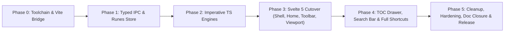

# Frontend Migration Roadmap — Vite + TypeScript + Svelte 5 (`CR-007`)

Execute phases strictly in sequence (`Phase 0` → `Phase 5`). Satisfy every item in a phase's **Exit Gate** before starting the next phase. Always consult [ARCHITECTURE.md](ARCHITECTURE.md) as the technical reference and follow the fixture-privacy rules in [AGENTS.md](../../AGENTS.md).

---

## 1. Phase Dependency Flow

### Why This Ordering Works
- **Zero downtime in Phases 0–2**: The existing vanilla app runs through Vite from Day 1 while the new typed IPC layer, Svelte 5 Runes store, and imperative TypeScript engines are built and unit-tested in isolation — no throwaway hybrid-island glue code needed.
- **Single clean cutover in Phase 3**: `index.html` switches to `src/main.ts` (`App.svelte`) once the entire core reading stack (store + actions + viewport + text-layer + tab-drag + Home + toolbar) is ready, giving an immediately usable end-to-end Svelte 5 app.
- **Controlled completion in Phases 4–5**: TOC, Search, and full keyboard parity land cleanly onto the live Runes store in Phase 4, followed by legacy removal, stress testing, governance doc closure, and standalone release verification in Phase 5.

---

## 2. Phase Index & Exit Gate Summary

| Phase | Guide | Core Deliverable | App Runtime During Phase | Primary Exit Gate |
| --- | --- | --- | --- | --- |
| **Phase 0** | [phase-0-toolchain-foundation.md](phases/phase-0-toolchain-foundation.md) | `pnpm`, Vite, TS, Svelte 5, Vitest, ESLint, Prettier, `tauri.conf.json` dev/build bridge | Legacy vanilla app served through Vite | `pnpm verify` + `cargo tauri dev` launches legacy app cleanly via Vite |
| **Phase 1** | [phase-1-ipc-and-runes-state.md](phases/phase-1-ipc-and-runes-state.md) | `src/lib/ipc/`, `src/lib/domain/`, `src/lib/state/` (Runes store, actions, `DocumentScope`, `PersistenceQueue`) | Legacy vanilla app untouched | Deep Vitest suite covers all state invariants, CR-001..CR-006 logic & race fixes; `pnpm verify` passes |
| **Phase 2** | [phase-2-imperative-engines.md](phases/phase-2-imperative-engines.md) | `src/lib/engines/` (`viewport.ts`, `text-layer.ts`, `tab-drag.ts`, `shortcuts.ts` + pure math/copy helpers) | Legacy vanilla app untouched | Pure math/copy/drag Vitest tests pass; zero direct `tab` mutations; `pnpm verify` passes |
| **Phase 3** | [phase-3-shell-home-and-reading-viewport.md](phases/phase-3-shell-home-and-reading-viewport.md) | `src/main.ts`, `src/styles/`, `App.svelte`, `TabStrip`, `WindowControls`, `NoticeBanner`, `HomeScreen`, `RecentFiles`, `Toolbar`, `ViewportHost`, `DropOverlay`, `withGlobalTauri: false` | **Cutover to Svelte 5** (core reading loop live) | `pnpm verify` + live `cargo tauri dev` passes multi-tab, Home, recents search/pagination, HiDPI scroll/zoom, text copy |
| **Phase 4** | [phase-4-toc-search-and-shortcuts.md](phases/phase-4-toc-search-and-shortcuts.md) | `TocDrawer.svelte`, `TocTree.svelte`, `SearchBar.svelte`, search highlight sync, complete `shortcuts.ts` wiring | Svelte 5 full feature parity | `pnpm verify` + live `cargo tauri dev` passes TOC, in-document search, and full keyboard audit |
| **Phase 5** | [phase-5-cleanup-hardening-and-release.md](phases/phase-5-cleanup-hardening-and-release.md) | Delete legacy vanilla files, stress/a11y audit, update `AGENTS.md` + `docs/CHANGES.md` + baseline notes, Windows release build | Production Svelte 5 bundle (`dist/`) | `pnpm verify` + Rust `fmt`/`clippy`/`test` + standalone `cargo tauri build` verified |

---

## 3. Complete Vanilla-to-Svelte File Migration Map

| Legacy File | Replaced By | Built In | Deleted In |
| --- | --- | --- | --- |
| `src/index.html` | Root `index.html` (Vite entry) | Phase 0 | Phase 0 (moved) |
| `src/logo.png` | `public/logo.png` | Phase 0 | Phase 0 (moved) |
| `src/api.js` | `src/lib/ipc/{types,errors,binary,client}.ts` | Phase 1 | Phase 5 |
| `src/tabs.js` | `src/lib/state/app-store.svelte.ts`, `src/lib/state/actions.ts`, `src/lib/domain/title.ts`, `src/lib/engines/tab-drag.ts`, `src/components/TabStrip.svelte` | Phases 1–3 | Phase 5 |
| `src/main.js` | `src/lib/state/{actions,persistence,doc-scope}.ts`, `src/main.ts`, `src/App.svelte`, `src/components/WindowControls.svelte`, `src/components/NoticeBanner.svelte`, `src/components/DropOverlay.svelte` | Phases 1, 3 | Phase 5 |
| `src/empty-state.js` | `src/lib/domain/{recents,format-error}.ts`, `src/components/HomeScreen.svelte`, `src/components/RecentFiles.svelte` | Phases 1, 3 | Phase 5 |
| `src/toolbar.js` | `src/lib/domain/zoom.ts`, `src/components/Toolbar.svelte` | Phases 1, 3 | Phase 5 |
| `src/viewport.js` | `src/lib/engines/{viewport-math,viewport}.ts`, `src/components/ViewportHost.svelte` | Phases 2, 3 | Phase 5 |
| `src/text-layer.js` | `src/lib/engines/{text-copy,text-layer}.ts` | Phase 2 | Phase 5 |
| `src/toc.js` | `src/lib/domain/outline.ts`, `src/components/{TocDrawer,TocTree}.svelte` | Phases 1, 4 | Phase 5 |
| `src/search.js` | `src/lib/domain/search.ts`, `src/components/SearchBar.svelte` | Phases 1, 4 | Phase 5 |
| `src/shortcuts.js` | `src/lib/engines/shortcuts.ts` | Phases 2, 4 | Phase 5 |
| `src/styles.css` | `src/styles/{tokens,base,viewport-layers}.css` + component `<style>` blocks | Phases 3, 4 | Phase 5 |

---

## 4. Behavioral Parity & Defect-Resolution Matrix

Every existing v1 + post-v1 feature and every diagnosed state/sync defect is explicitly assigned to a phase for implementation and verification:

| Requirement / Fix | Source | Implemented In | Verified In |
| --- | --- | --- | --- |
| Open via dialog (`Ctrl+O`), drag-drop, CLI arg, recent list; canonical dedup (`already_open`) | [SPEC §1](../SPEC.md#v1-goals) | Phases 1, 3 | Phases 1, 3, 5 |
| Virtualized HiDPI canvas viewport (`±2` overscan, `±6` eviction, DPR snap & monitor switch, zoom anchor) | [SPEC §5](../SPEC.md#virtualized-viewport--tab-memory-rules) | Phases 2, 3 | Phases 2, 3, 5 |
| Transparent HTML text overlay + geometric `Ctrl+C` clipboard formatting + selection-safe eviction | [SPEC §1](../SPEC.md#v1-goals), Phase 5 | Phases 2, 3 | Phases 2, 3, 5 |
| Singleton `Home` tab (`+`), in-place replacement, auto-pruning on last-doc close, `returnToTabId` | [CR-001](../changes/001-tab-add-home-screen.md) | Phases 1, 3 | Phases 1, 3, 5 |
| Borderless integrated 32px titlebar, 36px min drag handle, caption controls & `onResized` maximize sync | [CR-002](../changes/002-integrated-titlebar-window-controls.md) | Phase 3 | Phases 3, 5 |
| Pointer drag-reorder (`5px` threshold, hysteresis, edge auto-scroll, `Esc` cancel) & `Ctrl+Shift+Arrow` | [CR-003](../changes/003-tab-strip-reorder.md) | Phases 1, 2, 3 | Phases 1, 2, 3, 5 |
| Unbounded recents with 10/page pagination, ellipsis pager & keyboard focus preservation | [CR-004](../changes/004-paginated-unbounded-recents.md) | Phases 1, 3 | Phases 1, 3, 5 |
| Home `.recent-header` multi-token live search, `Ctrl+F` focus on Home, `Esc` clear-then-blur, `ArrowDown` | [CR-006](../changes/006-home-recent-search.md) | Phases 1, 3, 4 | Phases 1, 3, 4, 5 |
| Collapsible TOC drawer, lazy cached outline, active chapter + collapsed-ancestor fallback, WAI-ARIA tree keys | [SPEC §5](../SPEC.md#core-layout-wireframe), Phase 4 | Phases 1, 4 | Phases 1, 4, 5 |
| Per-tab `Ctrl+F` search bar, debounced IPC, `current / total`, wrap-around cycling, scaled highlight overlays | [SPEC §5](../SPEC.md#core-layout-wireframe), Phase 5 | Phases 1, 4 | Phases 1, 4, 5 |
| **Fix 1**: Eliminate shared mutable `tab` bag & 5x duplicated transition choreography | [README §1](README.md#1-context--problem-statement) | Phase 1 | Phases 1, 3 |
| **Fix 2**: Stop spurious `save_reading_state` writes on initial tab switch/mount | [README §1](README.md#1-context--problem-statement) | Phases 1, 2 | Phases 1, 3 |
| **Fix 3**: Replace single-slot `pendingSavePayload` with per-path `PersistenceQueue` | [README §1](README.md#1-context--problem-statement) | Phase 1 | Phases 1, 5 |
| **Fix 4**: Guard all per-tab async IPC (`getOutline`, `searchDocument`, `getPageText`, `renderPage`) with `DocumentScope` + unify Home/Workspace banner state | [README §1](README.md#1-context--problem-statement) | Phases 1, 3, 4 | Phases 1, 4, 5 |

---

## 5. Non-Negotiable Cross-Phase Guardrails

- **No Rust source changes**: `src-tauri/src/` and `src-tauri/Cargo.toml` must remain untouched across all phases (only `src-tauri/tauri.conf.json` updates in Phase 0 and Phase 3).
- **No scope creep**: Do not add themes/dark mode, annotations, PDF links, split views, printing, or extra toolbar chrome.
- **Fixture privacy**: Never track, stage, commit, or mention any specific PDF filename from `tests/fixtures/` in code, tests, docs, or commit messages.
- **UI design discipline**: Before writing or reshaping Svelte UI templates/CSS in Phases 3 and 4, consult `.agents/skills/frontend-design/SKILL.md` to ensure visual fidelity to the locked 6-token palette, keyboard focus visibility, and `prefers-reduced-motion` support.
