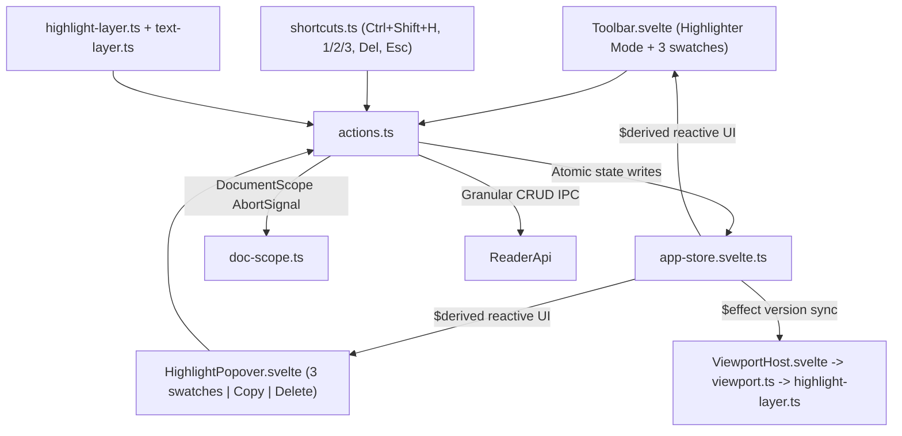

# Technical Architecture: Minimalist On-Page Text Highlights (`CR-010`)

Authoritative technical design for `reader`'s on-page 3-color text highlighting feature across the Rust backend (`src-tauri/src/`) and Vite + TypeScript + Svelte 5 frontend (`src/`).

---

## 1. Content Fingerprinting & On-Disk Persistence (`src-tauri/src/highlights.rs`)

### 1.1 Deterministic Content Fingerprint (`compute_document_fingerprint`)

To preserve user highlights when a PDF is moved or renamed — without hashing hundreds of megabytes on every document open or adding external crates — `reader` computes a deterministic 256-bit content fingerprint using a small, self-contained pure-Rust **FIPS 180-4 `SHA-256`** implementation (~85 LOC, verified against official NIST test vectors).

```text
FINGERPRINT_SAMPLE_BYTES = 65_536  (64 KiB)
FINGERPRINT_FULL_THRESHOLD = 3 * 65_536 = 196_608 bytes (192 KiB)

Input fed to SHA-256:
  1. Domain prefix: b"reader-fp-v1:"
  2. Exact file size: file_len.to_le_bytes() (8 bytes)
  3. Content bytes:
     - If file_len <= 196_608:
         Read and hash entire file [0 .. file_len].
     - If file_len > 196_608:
         Head sample:   65_536 bytes at offset 0
         Middle sample: 65_536 bytes at offset (file_len / 2) - 32_768
         Tail sample:   65_536 bytes at offset file_len - 65_536

Output: lowercase 64-character hex string (e.g. "a3f1...9c04").
```

**Properties**:
- **Move & rename resilient**: Dependent solely on file content and size, never on path or modification timestamp.
- **Fast**: At most `3` seeks / `192 KiB` read (`< 1 ms` even on 500 MB PDFs).
- **Safe filename**: Strictly 64 lowercase ASCII hex characters (`[0-9a-f]{64}`), preventing path traversal when constructing `<highlights_dir>/<fingerprint>.json`.
- **Zero new crates**: No `sha2` or `uuid` crate added to `src-tauri/Cargo.toml`.

### 1.2 On-Disk Storage Layout & JSON Schema

Highlights are stored per document under `<app_data_dir>/highlights/<fingerprint>.json` (sibling to `<app_data_dir>/state.json` and `<app_data_dir>/covers/`).

```json
{
  "version": 1,
  "fingerprint": "0123456789abcdef0123456789abcdef0123456789abcdef0123456789abcdef",
  "last_known_path": "C:\\Users\\example\\Documents\\book.pdf",
  "highlights": [
    {
      "id": "550e8400-e29b-41d4-a716-446655440000",
      "color": "yellow",
      "segments": [
        {
          "page_index": 12,
          "rects": [
            { "x": 0.1204, "y": 0.2410, "width": 0.6812, "height": 0.0185 }
          ]
        }
      ],
      "quote": "Selected passage text formatted cleanly.",
      "created_at_unix": 1764240000,
      "updated_at_unix": 1764240000
    }
  ]
}
```

### 1.3 Rust Domain Types & Validation Invariants

```rust
/// Schema version for `<app_data_dir>/highlights/<fingerprint>.json`.
pub const HIGHLIGHTS_SCHEMA_VERSION: u32 = 1;

/// Hard defensive caps protecting memory and disk serialization.
pub const MAX_HIGHLIGHTS_PER_DOCUMENT: usize = 5_000;
pub const MAX_SEGMENTS_PER_HIGHLIGHT: usize = 64;
pub const MAX_RECTS_PER_SEGMENT: usize = 512;
pub const MAX_QUOTE_BYTES: usize = 32_768;
pub const MAX_HIGHLIGHT_ID_BYTES: usize = 128;

#[derive(Debug, Clone, Copy, PartialEq, Eq, Serialize, Deserialize)]
#[serde(rename_all = "snake_case")]
pub enum HighlightColor {
    Yellow,
    Green,
    Pink,
}

#[derive(Debug, Clone, PartialEq, Serialize, Deserialize)]
pub struct HighlightSegment {
    pub page_index: usize,
    pub rects: Vec<NormalizedRect>,
}

#[derive(Debug, Clone, PartialEq, Serialize, Deserialize)]
pub struct HighlightRecord {
    pub id: String,
    pub color: HighlightColor,
    pub segments: Vec<HighlightSegment>,
    pub quote: String,
    pub created_at_unix: u64,
    pub updated_at_unix: u64,
}

#[derive(Debug, Clone, PartialEq, Serialize, Deserialize)]
pub struct DocumentHighlightsFile {
    pub version: u32,
    pub fingerprint: String,
    pub last_known_path: Option<String>,
    #[serde(default)]
    pub highlights: Vec<HighlightRecord>,
}
```

**Mandatory Validation & Persistence Rules**:
1. **Strict fingerprint validation**: Every IPC boundary validates `is_valid_fingerprint(fp)` (`fp.len() == 64 && fp.bytes().all(|b| matches!(b, b'0'..=b'9' | b'a'..=b'f'))`). Rejects anything else with `ReaderError::InvalidHighlight`.
2. **Strict highlight ID validation**: Non-empty, `<= MAX_HIGHLIGHT_ID_BYTES`, restricted to ASCII `[A-Za-z0-9_-]`.
3. **Geometry sanitization**:
   - `segments` must be non-empty (`1..=MAX_SEGMENTS_PER_HIGHLIGHT`), with no duplicate `page_index` (or normalized/sorted ascending by `page_index`).
   - Each segment must contain `1..=MAX_RECTS_PER_SEGMENT` finite rectangles with `x`, `y`, `width`, `height` clamped to `[0.0, 1.0]`, `x + width <= 1.0`, `y + height <= 1.0`, and `!rect.is_empty()`.
   - `quote` is truncated cleanly on a UTF-8 char boundary if exceeding `MAX_QUOTE_BYTES` (or rejected if invalid).
4. **Atomic disk writes**: Identical to `state.rs` (`<fingerprint>.json.tmp` → write JSON → `sync_all()` → drop handle → `fs::rename`, removing `.tmp` on failure so Windows never leaves half-written files).
5. **Empty-file auto-cleanup**: Deleting the final highlight of a document deletes `<fingerprint>.json` cleanly (ignoring `ErrorKind::NotFound`), keeping `<app_data_dir>/highlights/` clutter-free.
6. **Corrupt/unknown-version recovery**: If `<fingerprint>.json` contains malformed JSON or `version != HIGHLIGHTS_SCHEMA_VERSION`, log a warning to `stderr` and return an empty list without crashing.
7. **Recent-list independence**: `AppState::remove_recent_file` removes only the recent-list entry and cached cover bitmap — it **never** deletes highlight files.
8. **Concurrency**: `HighlightStore` protects load-modify-save sequences with an internal `Mutex<()>` (or per-fingerprint lock) invoked inside `tauri::async_runtime::spawn_blocking` so Tauri's async runtime and `doc-worker` never block on disk I/O.

---

## 2. Rust Backend & Tauri IPC Contract

### 2.1 Error Extension (`src-tauri/src/error.rs`)

Add one explicit error variant (matching existing `snake_case` wire codes):
- `ReaderError::InvalidHighlight(String)` → code `"invalid_highlight"` (used for malformed fingerprints, empty/invalid highlight geometry, missing highlight ID on update/delete, or document capacity exceeded).

### 2.2 Document Open Fingerprint (`worker.rs`, `commands.rs`)

- **`OpenedDocument`** (`src-tauri/src/worker.rs`) and **`OpenDocumentResponse`** (`src-tauri/src/commands.rs`) add one additive field:
  ```rust
  /// Content-derived SHA-256 fingerprint identifying this document across moves/renames.
  pub document_fingerprint: String,
  ```
- In `handle_open()` (`worker.rs`), compute `compute_document_fingerprint(&canonical_path)?` once on open and cache it on `OpenDocument` so re-opening an already-open tab (`already_open: true`) returns the cached fingerprint with zero extra disk I/O.
- `DocumentBackend` trait (`src-tauri/src/backend/mod.rs`) does **not** need new PDFium methods — source PDFs remain read-only and format-agnostic.

### 2.3 New Tauri IPC Commands (`commands.rs`, `lib.rs`)

All commands use `#[tauri::command(rename_all = "snake_case")]` and run disk I/O via `tauri::async_runtime::spawn_blocking`:

| Command | Input Payload | Output | Behavior |
| --- | --- | --- | --- |
| `get_highlights` | `{ fingerprint: String }` | `Vec<HighlightRecord>` | Validates fingerprint; loads `<fingerprint>.json` or returns `[]` if missing/corrupt. |
| `create_highlight` | `{ fingerprint: String, last_known_path: Option<String>, id: String, color: HighlightColor, segments: Vec<HighlightSegment>, quote: String }` | `HighlightRecord` | Validates inputs & caps, sets `created_at_unix` / `updated_at_unix`, appends (rejecting duplicate `id`), saves atomically, returns persisted record. |
| `update_highlight_color` | `{ fingerprint: String, id: String, color: HighlightColor }` | `HighlightRecord` | Validates fingerprint & `id`, updates `color` and `updated_at_unix`, saves atomically, returns updated record (returns `InvalidHighlight` if `id` not found). |
| `delete_highlight` | `{ fingerprint: String, id: String }` | `bool` | Removes matching highlight by `id`, saves atomically (or deletes file if empty), returns `true` if removed or `false` if already absent (idempotent). |

### 2.4 Frontend Typed IPC Mirror (`src/lib/ipc/{types,client}.ts`)

```ts
// src/lib/ipc/types.ts additions
export type ErrorCode =
  | "io"
  | "unsupported_format"
  | "password_protected"
  | "invalid_document"
  | "page_out_of_range"
  | "document_not_found"
  | "cancelled"
  | "unsupported_uri"
  | "invalid_highlight"
  | "internal";

export type HighlightColor = "yellow" | "green" | "pink";

export interface HighlightSegment {
  readonly page_index: number;
  readonly rects: NormalizedRect[];
}

export interface HighlightRecord {
  readonly id: string;
  readonly color: HighlightColor;
  readonly segments: HighlightSegment[];
  readonly quote: string;
  readonly created_at_unix: number;
  readonly updated_at_unix: number;
}

export interface OpenDocumentResponse {
  readonly document_id: number;
  readonly canonical_path: string;
  readonly document_fingerprint: string;
  readonly metadata: DocumentMetadata;
  readonly page_dimensions: PageDimensions[];
  readonly saved_position: ReadingPosition | null;
  readonly already_open: boolean;
}
```

```ts
// src/lib/ipc/client.ts additions on ReaderApi
export interface CreateHighlightParams {
  readonly fingerprint: string;
  readonly lastKnownPath?: string | null;
  readonly id: string;
  readonly color: HighlightColor;
  readonly segments: readonly HighlightSegment[];
  readonly quote: string;
}

export interface ReaderApi {
  // ...existing methods...
  getHighlights(fingerprint: string): Promise<HighlightRecord[]>;
  createHighlight(params: CreateHighlightParams): Promise<HighlightRecord>;
  updateHighlightColor(
    fingerprint: string,
    id: string,
    color: HighlightColor,
  ): Promise<HighlightRecord>;
  deleteHighlight(fingerprint: string, id: string): Promise<boolean>;
}
```

---

## 3. Pure Domain Geometry & Overlap Rules (`src/lib/domain/highlights.ts`)

All highlight geometry calculations live in a DOM-free pure TypeScript module covered exhaustively by Vitest:

1. **Constants**:
   - `HIGHLIGHT_COLORS = ["yellow", "green", "pink"] as const`
   - `DEFAULT_HIGHLIGHT_COLOR: HighlightColor = "yellow"`
   - `MIN_HIGHLIGHT_RECT_DIMENSION = 0.0005` (discards sub-pixel degenerate slivers)
   - `SAME_LINE_Y_TOLERANCE_RATIO = 0.35` (vertical midpoint alignment as fraction of min rect height)
   - `SAME_LINE_GAP_TOLERANCE_RATIO = 0.6` (horizontal gap relative to line height to merge adjacent fragments on the same visual line without bridging multi-column gutters)
   - `NEAR_DUPLICATE_OVERLAP_THRESHOLD = 0.92`

2. **`normalizeHighlightSegments(rawSegments)`**:
   - Clamps every `NormalizedRect` to `[0.0, 1.0]` and discards empty/degenerate rectangles (`width < MIN_HIGHLIGHT_RECT_DIMENSION || height < MIN_HIGHLIGHT_RECT_DIMENSION`).
   - Merges entries sharing the same `page_index`, sorts rects top-to-bottom (`y`) then left-to-right (`x`), and coalesces adjacent same-line rects (same vertical band within `SAME_LINE_Y_TOLERANCE_RATIO` and horizontal gap `<= minHeight * SAME_LINE_GAP_TOLERANCE_RATIO`) into crisp continuous line bars.
   - Sorts final segments ascending by `page_index` and omits empty segments.

3. **`groupHighlightsByPage(highlights)`**:
   - Builds `Map<number, PageHighlightEntry[]>` where each entry is `{ highlightId, color, rects, zIndex }` preserving creation order (`zIndex` ascending so later highlights paint on top and win reverse-scan hit-testing).

4. **`findNearDuplicateHighlight(existing, candidateSegments)`**:
   - Evaluates symmetric area overlap ratio (`intersectionArea / unionArea`, i.e., 2D IoU summed across all `page_index` segments) between `candidateSegments` and each existing highlight that touches the same set of pages.
   - Returns the top-most (newest) existing `HighlightRecord` whose 2D IoU `>= NEAR_DUPLICATE_OVERLAP_THRESHOLD` (`0.92`), or `null`.
   - Callers apply the locked overlap policy:
     - Match found & `existing.color === activeColor` → **no-op** (quietly clear selection).
     - Match found & `existing.color !== activeColor` → **recolor** `existing.id` to `activeColor` instead of creating a duplicate.
     - No match → **create** new independent highlight.

5. **`hitTestPageHighlights(entries, normX, normY)`**:
   - Reverse-scans `entries` (newest / highest `zIndex` first) and returns `{ highlightId, rect }` for the first matching normalized rect containing `(normX, normY)`, or `null`.

---

## 4. Svelte 5 Runes State & Unidirectional Actions (`src/lib/state/`)



### 4.1 Store Schema Additions (`src/lib/state/types.ts`, `app-store.svelte.ts`)

Per-document highlight slice on `DocState`:
```ts
export interface DocHighlightState {
  status: "idle" | "loading" | "loaded" | "error";
  items: HighlightRecord[];
  byPage: Map<number, PageHighlightEntry[]>;
  /** Monotonic counter bumped whenever highlight-layer DOM must repaint. */
  version: number;
  errorMessage: string | null;
}

export interface DocState {
  readonly documentId: number;
  readonly canonicalPath: string;
  readonly documentFingerprint: string;
  // ...existing fields...
  highlights: DocHighlightState;
}
```

App-level highlight interaction state on `AppStore`:
```ts
export interface ActiveHighlightPopover {
  readonly documentId: number;
  readonly highlightId: string;
  /** Anchor coordinates relative to `.viewport-host` client frame (recomputed or dismissed on scroll). */
  readonly anchorRect: {
    readonly left: number;
    readonly top: number;
    readonly width: number;
    readonly height: number;
  };
}
```
- `highlighterMode: boolean` (`$state(false)`) — app-level mode toggle (visible on Toolbar when a document is active; remains `false` by default).
- `activeHighlightColor: HighlightColor` (`$state<HighlightColor>("yellow")`) — remembers the last chosen color across Highlighter Mode toggles and tabs during the session.
- `activeHighlightPopover: ActiveHighlightPopover | null` (`$state.raw(null)`) — currently inspected highlight popover (at most one open globally).
- `ToolbarModel` gains:
  - `readonly highlighterMode: boolean`
  - `readonly activeHighlightColor: HighlightColor`

### 4.2 Actions & Lifecycle Rules (`src/lib/state/actions.ts`)

| Action | Behavior |
| --- | --- |
| `ensureHighlightsLoaded(documentId)` | Triggered automatically when opening a document (not on Home). Guarded by `scopes.getSignal(documentId)`; populates `doc.highlights.{items, byPage, status, version}`. On failure, sets non-fatal `status = "error"` and surfaces workspace banner without blocking reading. |
| `toggleHighlighterMode()` / `setHighlighterMode(active)` | Toggles `store.highlighterMode`; clears active browser selection when entering mode; dismisses open popover if needed. |
| `setActiveHighlightColor(color)` | Updates `store.activeHighlightColor` (`"yellow" \| "green" \| "pink"`). |
| `createHighlightFromSelection(documentId, rawSegments, quote)` | Normalizes segments via `normalizeHighlightSegments`. If empty, returns cleanly. Runs `findNearDuplicateHighlight`: same color → no-op; different color → delegates to `recolorHighlight`; else generates `id = crypto.randomUUID()`, optimistically appends `HighlightRecord` to **all open tabs matching `doc.documentFingerprint`**, bumps `version`, and calls `api.createHighlight(...)`. Rolls back and shows workspace `banner` on IPC error. |
| `recolorHighlight(documentId, highlightId, color)` | No-op if color already matches. Optimistically updates `color` across all open tabs sharing `doc.documentFingerprint`, bumps `version`, persists via `api.updateHighlightColor(...)`; rolls back + shows workspace `banner` on IPC failure. |
| `deleteHighlight(documentId, highlightId)` | Closes `activeHighlightPopover` if targeting `highlightId`. Optimistically removes record across all open tabs sharing `doc.documentFingerprint`, bumps `version`, persists via `api.deleteHighlight(...)`; rolls back + shows workspace `banner` on IPC failure. |
| `openHighlightPopover(popover)` / `closeHighlightPopover()` | Opens or dismisses `store.activeHighlightPopover`. Automatically cleared inside `deactivateCurrentDocument()` (tab switch, Home switch, tab close), zoom changes, and viewport scroll. |
| `copyHighlightQuote(documentId, highlightId)` | Copies `highlight.quote` to system clipboard (`navigator.clipboard.writeText`), closes popover, and surfaces subtle error banner only if clipboard write fails. |

---

## 5. Imperative Viewport Layer Stack, Selection Extraction & Hit-Testing

### 5.1 Updated `.page-slot` Stacking Order (`src/styles/viewport-layers.css`)

```text
.page-slot (position: absolute; overflow: hidden; background: #FFFFFF)
 ├── z-index: 1  .page-canvas      (HiDPI PDFium RGBA8 canvas, pointer-events: none)
 ├── z-index: 2  .highlight-layer  (User color highlights, mix-blend-mode: multiply, pointer-events: none)
 ├── z-index: 3  .search-layer     (Ctrl+F matches, mix-blend-mode: multiply, pointer-events: none)
 ├── z-index: 4  .link-layer       (Clickable PDF /Link overlays + keyboard .pdf-link-hit, pointer-events: none)
 └── z-index: 5  .text-layer       (Transparent selectable .text-span runs, pointer-events: auto on spans)
```

`HighlightPopover.svelte` mounts inside `.viewport-host` (sibling to `#viewport` and `SearchBar.svelte`) at **`z-index: 15`** (above viewport layers, below narrow-viewport `.toc-drawer` `z-index: 18` and `#app-chrome` `z-index: 20`) so it is **never** clipped by `.page-slot { overflow: hidden }`.

### 5.2 Hybrid Selection-to-Geometry Extraction (`src/lib/engines/text-layer.ts`)

Add `extractSelectionSegments(slotElements)` to `TextLayerEngine`, reusing the exact `subRange` traversal already proven in `handleCopy()`:

1. Verify `window.getSelection()` is non-collapsed and intersects `#viewport`.
2. Iterate `mountedLayers` sorted ascending by `pageIndex` (reusing `spanMetaByEl: WeakMap<HTMLElement, { pageIndex, rect }>`).
3. For every `.text-span` intersecting a `Selection` range:
   - Compute `subRange` clipped to `spanEl` (identical to `handleCopy()`).
   - Extract `piece = subRange.toString()`; skip whitespace-only/empty pieces when building visual rects (still retain fragments for `formatCopiedFragments()` so spaces/newlines stay accurate!).
   - Project `subRange.getBoundingClientRect()` horizontally into `slotRect = slotElements[pageIndex].getBoundingClientRect()`:
     - `rawX0 = (rangeRect.left - slotRect.left) / slotRect.width`
     - `rawX1 = (rangeRect.right - slotRect.left) / slotRect.width`
     - Clamp `[rawX0, rawX1]` within `[meta.rect.x, meta.rect.x + meta.rect.width]` so `scaleX` rounding never bleeds outside the PDFium text run.
   - Use **exact PDFium vertical bounds** `y = meta.rect.y`, `height = meta.rect.height`!
     - **Why**: Eliminates jagged vertical heights caused by Segoe UI fallback font ascent/descent metrics while retaining exact sub-word horizontal accuracy at any zoom level or DPR.
4. Collect fragments into `{ rawSegments, quote }` where `quote = formatCopiedFragments(fragments)`.
5. Pass to `normalizeHighlightSegments(rawSegments)` in `src/lib/domain/highlights.ts` to merge same-line fragments and sort cross-page segments cleanly.

### 5.3 Imperative Highlight Engine (`src/lib/engines/highlight-layer.ts`)

Follows the exact architecture and lifecycle discipline of `link-layer.ts` (zero Svelte imports, deterministic `destroy()`):

- **Rendering**:
  - Mounts `.highlight-layer` inside each visible/overscan `slotElement` that has `PageHighlightEntry[]` entries.
  - Renders `.pdf-highlight-group[data-highlight-id]` containing percentage-positioned `.pdf-highlight-rect.pdf-highlight-rect--{yellow|green|pink}` elements (`left/top/width/height` in `%` to 4 decimal places).
  - **Zero-cost zoom**: Because rects use `%` of `.page-slot`, zooming and DPR switches rescale highlights automatically without rebuilding DOM!
  - Syncs on scroll (`syncVisibleRange`), evicts outside `keepMin..keepMax` (`evictOutside`), and repaints mounted visible pages whenever `doc.highlights.version` advances (`syncHighlights`).
- **Pointer Interaction & Precedence**:
  - Tracks `pointerdown` (`button === 0`), `pointermove` (`DRAG_THRESHOLD_PX = 4`), `pointerup`, `pointerleave`, `scroll`, and `click` on `#viewport`:
    1. **Drag-to-highlight (`highlighterMode === true`)**: On `pointerup` after a primary pointer gesture where `hasActiveSelectionInsideViewport()` is true, extract `{ segments, quote }` via `textLayer.extractSelectionSegments(...)`, clear active browser selection (`textLayer.clearActiveSelection()`), and invoke `onCreateFromSelection(documentId, segments, quote)`.
    2. **Click-to-inspect (any mode)**: On primary non-drag click (`<= 4px`, `detail === 1`, collapsed selection, and `!isClickOnPdfLink(clientX, clientY)`):
       - Hit-test page highlights via `hitTestPageHighlights` (newest wins).
       - If hit: compute anchor rect relative to `.viewport-host` from the clicked highlight rect element and invoke `onSelectHighlight(documentId, highlightId, anchorRect)`.
       - If miss while a popover is open: invoke `onDismissPopover()`.
    3. **Hover feedback**: When pointer hovers over a highlight (and NOT hovering a PDF link, and NOT dragging), add `.pdf-highlight-group--hover` across all mounted segments of that highlight and `.viewport--highlight-hover` (`cursor: pointer`) on `#viewport`.
    4. **PDF link precedence (`link-layer.ts` coordination)**: Export `hasLinkAtClientPoint(clientX, clientY): boolean` on `LinkLayerEngine` so `highlight-layer.ts` yields both hover cursor and clicks whenever a clickable PDF `/Link` occupies that exact point.
    5. **Scroll / zoom dismissal**: Any `#viewport` `scroll` event clears hover state and calls `onDismissPopover()` immediately if a popover is open.

---

## 6. Visual Design Tokens, Toolbar Controls, Popover & Keyboard Precedence

> [!IMPORTANT]
> Per [AGENTS.md](../../AGENTS.md), Phases 3 and 4 **must** execute the mandatory two-pass `frontend-design` design plan and self-critique before writing Svelte/CSS code. The tokens and ergonomics below lock the functional contract.

### 6.1 Curated 3-Color Tokens (`src/styles/tokens.css`)

All three colors use `mix-blend-mode: multiply` over `#FFFFFF` PDF sheets and stay visually distinct from `--selection-bg` (`rgba(30, 77, 183, 0.24)`) and `--search-hit-bg` (`rgba(230, 168, 24, 0.26)`):

| Color ID | Page Fill (`multiply`) | Hover / Selected Fill | Swatch Dot Fill | Swatch Ring / Border |
| --- | --- | --- | --- | --- |
| `yellow` | `rgba(253, 224, 71, 0.42)` | `rgba(250, 204, 21, 0.56)` | `#f5d142` | `rgba(148, 112, 8, 0.42)` |
| `green` | `rgba(134, 217, 152, 0.38)` | `rgba(104, 201, 127, 0.52)` | `#6fc987` | `rgba(34, 108, 56, 0.40)` |
| `pink` | `rgba(244, 154, 178, 0.38)` | `rgba(235, 126, 157, 0.52)` | `#eb8ea9` | `rgba(148, 44, 78, 0.40)` |

### 6.2 Toolbar Layout (`src/components/Toolbar.svelte`)

Right toolbar group layout:
- **At rest (`highlighterMode === false`)**:
  `[- 100% +] | [Fit width] [Fit page] | [Highlighter] [Search] [Open]`
  - `#highlight-mode-btn` is a single `26×26px` `.icon-btn` with `HighlighterIcon` and a tiny `5px` active-color underline/indicator matching `activeHighlightColor` (`aria-pressed="false"`, `title="Highlighter mode (Ctrl+Shift+H)"`).
- **Active (`highlighterMode === true`)**:
  `[- 100% +] | [Fit width] [Fit page] | [Highlighter] [● ● ●] [Search] [Open]`
  - `#highlight-mode-btn` takes `aria-pressed="true"` styling (`--accent-tint` / `--accent-cobalt`).
  - Inline `#highlight-color-picker` (`role="radiogroup"`, `aria-label="Highlight color"`) renders 3 tactile `16×16px` swatch buttons (`Yellow (1)`, `Green (2)`, `Pink (3)`) with `aria-checked`, clear active ring (`--ink-primary` / `--accent-cobalt`), and `:focus-visible` ring.
  - Fits cleanly down to `640×480` alongside existing `@media (max-width: 740px)` label collapsing and horizontal toolbar overflow scroll.

### 6.3 On-Page Popover (`src/components/HighlightPopover.svelte`)

- Compact floating bar (`height: 32px`, `background: var(--surface-paper)`, `border: 1px solid var(--border-strong)`, quiet elevation shadow, `border-radius: var(--radius-md)`):
  `[● Yellow] [● Green] [● Pink] | [Copy] [Delete]`
- **Positioning**:
  - Anchored horizontally centered over `anchorRect` (clamped within `8px` padding of `.viewport-host` left/right edges).
  - Positioned `8px` **above** `anchorRect.top` by default; flips `8px` **below** `anchorRect.top + anchorRect.height` when insufficient vertical headroom (`< 44px`).
- **Dismissal**: Closes immediately on outside `pointerdown`, viewport `scroll`, `resize`, zoom change, tab switch, `Esc`, or `Delete`/`Backspace`.
- **Accessibility**: `role="toolbar"`, `aria-label="Highlight actions"`, active color swatch marked `aria-pressed="true"`, `:focus-visible` rings, respects `prefers-reduced-motion`.

### 6.4 Keyboard Shortcuts (`src/lib/engines/shortcuts.ts`)

| Shortcut | Precondition | Action |
| --- | --- | --- |
| `Ctrl+Shift+H` | `store.activeDoc !== null` (even if viewport or toolbar focused; not if `AltGr`) | Toggle Highlighter Mode (`actions.toggleHighlighterMode()`). |
| `1` / `2` / `3` | Unmodified, `!inEditable`, `!isInsideToc`, `store.activeDoc !== null`, `store.highlighterMode === true` | Switch `activeHighlightColor` (`1` = `yellow`, `2` = `green`, `3` = `pink`). Does not interfere with `Ctrl+1..9` tab switching. |
| `Delete` / `Backspace` | Unmodified, `!inEditable`, `store.activeHighlightPopover !== null` | Delete the currently selected highlight and dismiss popover. |
| `Esc` (5-step ladder) | Unmodified | 1. Non-search editable input → blur & focus viewport.<br>2. Open `HighlightPopover` → close popover & focus viewport.<br>3. Open `SearchBar` → close search bar.<br>4. Active `Highlighter Mode` → exit Highlighter Mode (`setHighlighterMode(false)`).<br>5. TOC / general focus → blur & focus viewport. |
