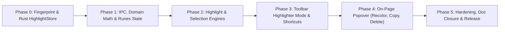

# Text Highlights Development Roadmap (`CR-010`)

Execute phases strictly in sequence (`Phase 0` → `Phase 5`). Satisfy every item in a phase's **Exit Gate** before starting the next phase. Always consult [ARCHITECTURE.md](ARCHITECTURE.md) as the technical reference and follow the Rust, UI, and fixture-privacy rules in [AGENTS.md](../../AGENTS.md).

---

## 1. Phase Dependency Flow

### Why This Ordering Works
- **Backend stability first (`Phase 0` → `Phase 1`)**: Content fingerprinting, atomic disk persistence, validation caps, IPC wiring, pure geometry/overlap helpers, and Svelte 5 Runes state reach 100% unit-test coverage before any DOM overlay or UI chrome changes land.
- **Imperative engine isolation (`Phase 2`)**: Selection-to-geometry extraction (`text-layer.ts`), virtualized highlight rendering (`highlight-layer.ts`), z-index layering, and PDF link precedence are built and verified deterministically in Vitest without polluting Svelte reactivity.
- **Incremental live UX (`Phase 3` → `Phase 4`)**: Phase 3 delivers end-to-end highlight creation + persistence via Toolbar Highlighter Mode and shortcuts; Phase 4 completes on-page recolor, quote copy, and delete via the quiet `HighlightPopover`.
- **Controlled release closure (`Phase 5`)**: Hardening on rotated/cropped/multi-column/duplicate-tab edge cases, restraint & Rust audits, baseline governance notes, and standalone Windows release build close `CR-010` cleanly.

---

## 2. Phase Index & Exit Gate Summary

| Phase | Guide | Core Deliverable | App Runtime During Phase | Primary Exit Gate |
| --- | --- | --- | --- | --- |
| **Phase 0** | [phase-0-rust-fingerprint-and-highlight-store.md](phases/phase-0-rust-fingerprint-and-highlight-store.md) | `src-tauri/src/highlights.rs` (pure-Rust `SHA-256` fingerprint + atomic `HighlightStore` + validation) & `ReaderError::InvalidHighlight` | Unchanged user-facing app | Rust unit tests cover NIST SHA-256, sampling, move/rename stability, caps, atomic save, empty cleanup, corrupt recovery; `cargo fmt`/`clippy`/`test` pass |
| **Phase 1** | [phase-1-ipc-domain-and-runes-state.md](phases/phase-1-ipc-domain-and-runes-state.md) | `document_fingerprint` on `open_document`, 4 Rust IPC commands (`get/create/update_color/delete`), TS IPC, `src/lib/domain/highlights.ts`, Runes store/actions + multi-tab sync | Highlights load silently on document open; zero visible UI change yet | Full Rust + Vitest suites cover IPC, rect merging, overlap IoU, optimistic rollback, `DocumentScope`, and duplicate-tab sync; `cargo test` + `pnpm verify` pass |
| **Phase 2** | [phase-2-highlight-and-selection-engines.md](phases/phase-2-highlight-and-selection-engines.md) | `text-layer.ts` `extractSelectionSegments`, new `highlight-layer.ts`, `link-layer.ts` `hasLinkAtClientPoint`, `viewport.ts` bridge, z-index + 3-color CSS tokens | Persisted highlights render crisply over PDFs (`mix-blend-mode: multiply`), zero chrome change yet | Vitest engine tests pass for geometry extraction, virtualized mount/evict, reverse z-order hit-testing, and link precedence; `pnpm verify` passes |
| **Phase 3** | [phase-3-toolbar-highlighter-mode-and-shortcuts.md](phases/phase-3-toolbar-highlighter-mode-and-shortcuts.md) | `HighlighterIcon.svelte`, `Toolbar.svelte` toggle + active inline 3-color swatches, `ViewportHost.svelte` drag-to-highlight wiring, `shortcuts.ts` (`Ctrl+Shift+H`, `1/2/3`, `Esc`) | **End-to-end highlight creation live** (toggle mode, drag single/multi-line/cross-page, reload & move/rename persist) | Two-pass `frontend-design` pass + `pnpm verify` + live `cargo tauri dev` verification on `tests/fixtures/*.pdf` |
| **Phase 4** | [phase-4-highlight-popover-and-interactions.md](phases/phase-4-highlight-popover-and-interactions.md) | `HighlightPopover.svelte`, `CopyIcon.svelte`, `TrashIcon.svelte`, click-to-inspect in any mode, recolor/copy/delete, `Delete`/`Backspace` shortcut, link-click precedence | **Full `CR-010` UX live** (create, recolor, copy cross-page quote, delete) | Two-pass `frontend-design` pass + `pnpm verify` + live `cargo tauri dev` verification of popover clamping, link precedence, and keyboard flow |
| **Phase 5** | [phase-5-hardening-doc-closure-and-release.md](phases/phase-5-hardening-doc-closure-and-release.md) | Rotated/cropped/multi-column/eviction/duplicate-tab stress audit, Rust & UI restraint audits, `SPEC.md`/`PHASES.md`/`AGENTS.md`/`CHANGES.md` closure, release build | Production Windows x64 bundle | `pnpm verify` + Rust `fmt`/`clippy`/`test` + standalone `cargo tauri build` + fixture privacy check pass |

---

## 3. Complete File Creation & Modification Map

| Layer | Action | Path | Built In |
| --- | --- | --- | --- |
| Rust Core | **NEW** | `src-tauri/src/highlights.rs` | Phase 0 |
| Rust Core | **MODIFY** | `src-tauri/src/error.rs` (`InvalidHighlight`), `src-tauri/src/lib.rs` (module export + command registration) | Phases 0, 1 |
| Rust IPC & State | **MODIFY** | `src-tauri/src/state.rs` (`HighlightStore` in `AppState`), `src-tauri/src/worker.rs` (`document_fingerprint`), `src-tauri/src/commands.rs` (4 CRUD commands + `OpenDocumentResponse`) | Phase 1 |
| Frontend IPC | **MODIFY** | `src/lib/ipc/types.ts`, `src/lib/ipc/client.ts` | Phase 1 |
| Frontend Domain | **NEW** | `src/lib/domain/highlights.ts` | Phase 1 |
| Frontend Domain | **MODIFY** | `src/lib/domain/format-error.ts` (highlight error copy) | Phase 1 |
| Frontend State | **MODIFY** | `src/lib/state/types.ts`, `src/lib/state/app-store.svelte.ts`, `src/lib/state/actions.ts` | Phase 1 |
| Frontend Engines | **NEW** | `src/lib/engines/highlight-layer.ts` | Phase 2 |
| Frontend Engines | **MODIFY** | `src/lib/engines/text-layer.ts`, `src/lib/engines/link-layer.ts`, `src/lib/engines/viewport.ts` | Phase 2 |
| Frontend Engines | **MODIFY** | `src/lib/engines/shortcuts.ts` | Phases 3, 4 |
| Frontend Styles | **MODIFY** | `src/styles/tokens.css`, `src/styles/viewport-layers.css` | Phase 2 |
| Frontend UI | **NEW** | `src/components/icons/HighlighterIcon.svelte` | Phase 3 |
| Frontend UI | **NEW** | `src/components/HighlightPopover.svelte`, `src/components/icons/CopyIcon.svelte`, `src/components/icons/TrashIcon.svelte` | Phase 4 |
| Frontend UI | **MODIFY** | `src/components/Toolbar.svelte`, `src/components/ViewportHost.svelte`, `src/App.svelte` | Phases 3, 4 |
| Tests | **NEW** | `src/lib/domain/__tests__/highlights.test.ts`, `src/lib/engines/__tests__/highlight-layer.test.ts` | Phases 1, 2 |
| Tests | **MODIFY** | `src/lib/state/__tests__/actions.test.ts`, `src/lib/engines/__tests__/link-layer.test.ts`, `src-tauri/tests/pdf_backend.rs` | Phases 1, 2, 4 |
| Governance Docs | **MODIFY** | `docs/SPEC.md`, `docs/PHASES.md`, `docs/CHANGES.md`, `docs/highlights/README.md`, `AGENTS.md` | Phase 5 |

---

## 4. Requirements & Edge-Case Traceability Matrix

| Requirement / Edge Case | Source | Implemented In | Verified In |
| --- | --- | --- | --- |
| App-data JSON storage (`<app_data_dir>/highlights/<fp>.json`), never modifying source PDFs | [README §2 ADR 1](README.md#2-locked-architectural-decisions-adr-summary) | Phases 0, 1 | Phases 0, 1, 5 |
| Deterministic content fingerprint (`SHA-256` size + head/mid/tail); survives move/rename | [README §2 ADR 2](README.md#2-locked-architectural-decisions-adr-summary) | Phases 0, 1 | Phases 0, 3, 5 |
| Pure color highlights (3 fixed colors: `yellow`, `green`, `pink`), zero notes/sidebars/undo | [README §2 ADR 3, 6, 7, 10](README.md#2-locked-architectural-decisions-adr-summary) | Phases 0–4 | Phases 3, 4, 5 |
| Reading Mode stays 100% quiet (drag-select only copies; zero selection popover) | [README §2 ADR 4](README.md#2-locked-architectural-decisions-adr-summary) | Phases 2, 3 | Phases 3, 4, 5 |
| Toolbar single `26×26px` toggle button expanding inline 3 color swatches when active | [README §2 ADR 11](README.md#2-locked-architectural-decisions-adr-summary) | Phase 3 | Phases 3, 5 |
| Cross-page unified highlight (`segments: [{ page_index, rects }]` + formatted `quote`) | [README §2 ADR 8](README.md#2-locked-architectural-decisions-adr-summary) | Phases 0–3 | Phases 1, 2, 3, 4, 5 |
| Independent overlap stacking + near-duplicate dedup (`>= 0.92` same color no-op / diff color recolor) | [README §2 ADR 9](README.md#2-locked-architectural-decisions-adr-summary) | Phases 1, 2, 3 | Phases 1, 2, 3, 5 |
| Any-mode primary non-drag click opens compact `[Yellow \| Green \| Pink \| Copy \| Delete]` popover | [README §2 ADR 5](README.md#2-locked-architectural-decisions-adr-summary) | Phases 2, 4 | Phases 2, 4, 5 |
| PDF `/Link` click & hover precedence over highlighted links | [ARCHITECTURE §5.3](ARCHITECTURE.md#53-imperative-highlight-engine-srclibengineshighlight-layerts) | Phases 2, 4 | Phases 2, 4, 5 |
| Multi-tab sync when identical PDF copies share fingerprint across two open tabs | [ARCHITECTURE §4.2](ARCHITECTURE.md#42-actions--lifecycle-rules-srclibstateactionsts) | Phase 1 | Phases 1, 5 |
| Deleting last highlight removes `.json`; `remove_recent_file` preserves highlights | [ARCHITECTURE §1.3](ARCHITECTURE.md#13-rust-domain-types--validation-invariants) | Phases 0, 1 | Phases 0, 5 |
| Keyboard shortcuts (`Ctrl+Shift+H`, `1`/`2`/`3`, `Delete`/`Backspace`, 5-step `Esc` ladder) | [ARCHITECTURE §6.4](ARCHITECTURE.md#64-keyboard-shortcuts-srclibenginesshortcutsts) | Phases 3, 4 | Phases 3, 4, 5 |

---

## 5. Non-Negotiable Cross-Phase Guardrails

- **Zero new dependencies**: Do not add crates to `src-tauri/Cargo.toml` or packages to `package.json`.
- **Zero PDF mutation**: Never write annotations into source PDF files or alter `state.json` schema (`version: 1`).
- **Scope discipline**: Do not add notes, underline/strikethrough, freehand drawing, Highlights Drawer, Undo/Redo, or custom color pickers.
- **Mandatory skill gates**:
  - Read `.agents/skills/rust-best-practices/SKILL.md` before Rust edits in Phases 0, 1, and 5 (zero `.unwrap()`/`.expect()`/`panic!` in production code; `cargo fmt --check`, `cargo clippy --all-targets --all-features --locked -- -D warnings`, `cargo test`).
  - Read `.agents/skills/frontend-design/SKILL.md` and run the mandatory two-pass design plan + self-critique before writing Svelte/CSS in Phases 3 and 4 (`pnpm verify` + live `cargo tauri dev`).
- **Fixture privacy**: Never track, stage, commit, or mention any specific PDF filename from `tests/fixtures/` in code, tests, docs, or commit messages.
